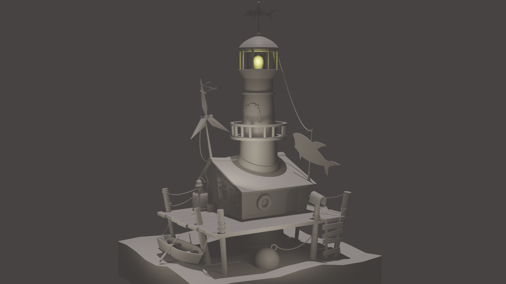
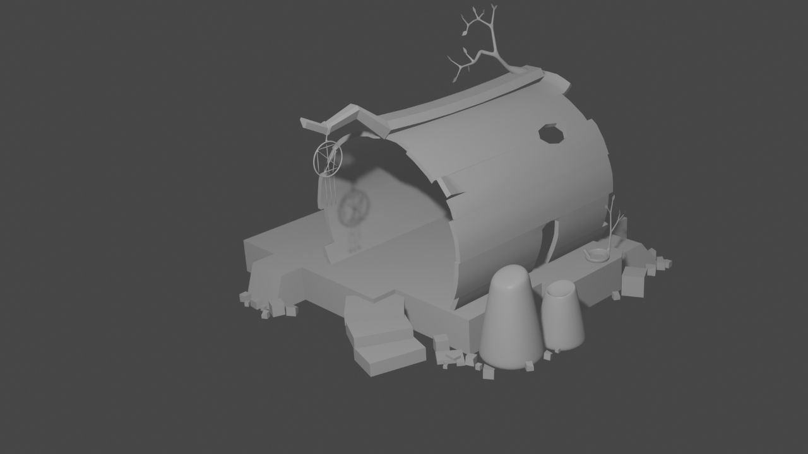
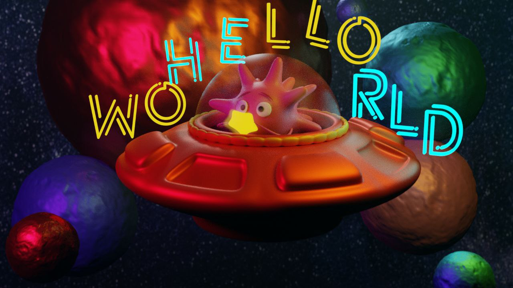
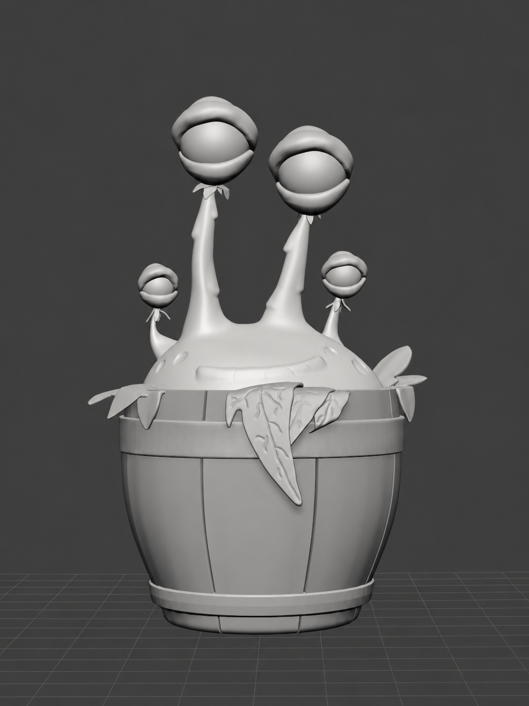

# 3D-портфолио | DXaten

Четыре выбранные работы, созданные в **Blender**: стилизованное окружение, персонаж и космическая сцена.

[Профиль и игровые проекты](README.md)

## Маяк

Сцена с маяком на деревянном причале. Лодка, лестница, канаты и небольшие предметы дополняют центральную башню. Серые материалы позволяют рассмотреть форму и детали окружения.

**Программа:** Blender. **Представлено:** общий вид сцены.

## Стилизованный дом

Компактная сцена с домом, изогнутой крышей, ступенями и небольшими предметами вокруг. Основной акцент изображения - силуэт и крупные формы.

**Программа:** Blender. **Представлено:** общий вид модели в серых материалах.

## Космическая сцена

Цветная композиция с персонажем в летающей тарелке, планетами и светящейся надписью «Hello World». Изображение показывает работу с формой, цветом и освещением сцены.

**Программа:** Blender. **Представлено:** цветное изображение сцены.

## Персонаж в бочке

  

Стилизованная модель с четырьмя отростками, листьями и бочкой. Серые материалы показывают силуэт, объём и детали переднего листа.

**Программа:** Blender. **Представлено:** восстановленное изображение модели.

Исходник был снят на телефон с экрана компьютера. Для этой версии с помощью ImageGen убраны артефакты съёмки монитора. [Исходная фотография](assets/blender/kentik-original.jpg) сохранена рядом для сравнения.
